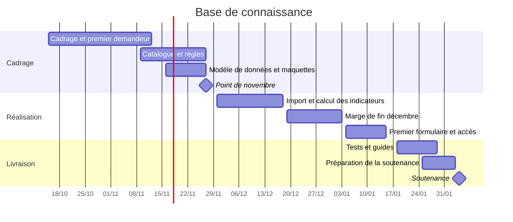

# Planning prévisionnel

Référence de cadrage : **15 octobre 2026**. Soutenance : **4 février 2027**.

Le travail suit quatre étapes : définir les indicateurs, organiser les données d’insertion, remplir le formulaire d’un premier demandeur, puis étendre le périmètre.

Les dates intermédiaires sont des objectifs à ajuster selon les séances et les points avec la cliente. La date exacte du bilan de novembre sera confirmée avec M. Haddad. Ce bilan rassemble les grilles d’autoévaluation et les traces des contributions.
