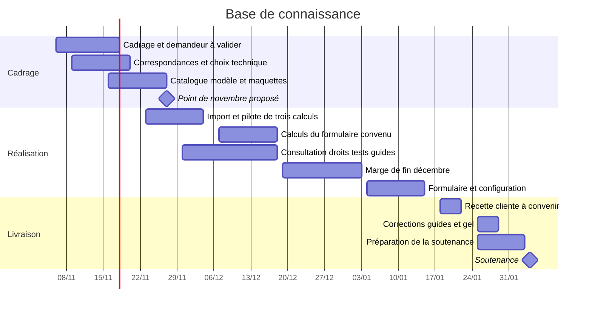

# Planning prévisionnel

Version du **6 novembre 2026**. Soutenance : **4 février 2027**. Les barres représentent le travail prévu.

Le travail suit quatre étapes : définir les indicateurs, organiser les données d’insertion, remplir le formulaire d’un premier demandeur, puis étendre le périmètre.

| Cible proposée | Résultat attendu | Responsable | Dépendance |
|---|---|---|---|
| 18 novembre | Demandeur, modèle et règles prioritaires convenus | Flavien, avec Abderrahim et Louka | Réponse de la cliente ; objectif à convenir avec elle |
| 20 novembre | Correspondances par feuille ; choix technique après essai des cinq feuilles | Abderrahim ; Ahdi | Champs métier clarifiés pour les calculs concernés |
| 27 novembre | Catalogue initial, modèle de données, maquettes, grilles et traces individuelles | Équipe ; bilan Rayen et Flavien | Date du point académique à confirmer avec M. Haddad |
| 4 décembre | Import contrôlé et pilote FI001/FI005/FI012 comparé aux valeurs manuelles | Ahdi et Abderrahim ; tests Rayen | Règles métier validées par la cliente |
| 18 décembre | Calculs des champs obligatoires du formulaire convenu et tests | Abderrahim ; Rayen | Modèle, formations et règles validés ; ajuster le lot sinon |
| 15 janvier | Consultation, accès par service, formulaire intégré et démonstration FI014 par configuration | Louka, Ahdi et Abderrahim ; Rayen | Calculs et modèle disponibles |
| 18–22 janvier | Recette métier et essai d’ergonomie par une ou deux personnes d’un service | Équipe et cliente | Disponibilités à convenir |
| 29 janvier | Corrections et guides terminés ; version de démonstration gelée | Équipe ; guides Rayen ; lancement Flavien et Ahdi | Réserves résolues ou consignées |
| 4 février | Soutenance et démonstration | Équipe | Répétitions jusqu’au 3 février |

Sans modèle reçu au **20 novembre**, l’extrait CTI 2023 servira de gabarit provisoire à faire approuver. Cela ne vaut pas validation du demandeur ou des chiffres. Si un arbitrage bloque un calcul, consigner son impact et revoir la cible avec la cliente ; poursuivre les parties indépendantes sur données fictives.

Tests et guides accompagnent le développement. La marge de fin décembre tient compte des disponibilités à confirmer ; elle n’est pas une capacité de travail acquise. Après le gel du 29 janvier, conserver la marge pour les anomalies bloquantes et les répétitions.

Chaque étudiant renseignera sa grille officielle avec les liens vers ses contributions réelles : commits, pull requests, livrables et tâches Trello. Rayen et Flavien consolideront le bilan. Les grilles restent privées.
