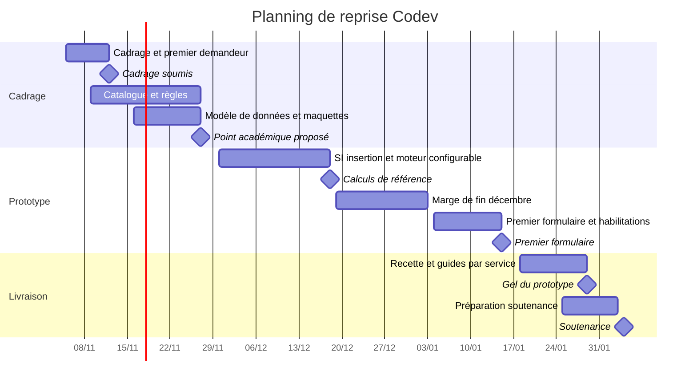

# Planning et échéances

## Consignes reçues

Selon le mail de M. Haddad du 25 septembre, transmis par l’équipe :

- **Lundi 5 octobre** : cahier des charges validé, rôles attribués et planning incluant la soutenance ; retour par mail avec les membres et la cliente en copie.
- **Novembre** : point d’avancement, grilles d’autoévaluation et dépôt Git avec les premières traces.
- **4 février** : soutenance.

Le 5 octobre 2026 était bien un lundi. Le calendrier de travail utilise 2026–2027, cohérent avec la soutenance du 4 février 2027 figurant dans le document partagé. Au 5 novembre, la validation du premier jalon n’est pas documentée. Ne pas le marquer comme terminé sur la seule base du dépôt créé.

## Gantt de reprise proposé

Ces jalons sont des propositions. La date exacte du point académique de novembre et les disponibilités ne sont pas encore connues. Le 12 novembre correspond à une remise proposée, pas à une validation cliente présumée.

## Suivi

Après chaque séance, mettre à jour Trello et les décisions. La cliente valide règles et modèle documentaire avant calcul et génération définitifs. Les accords de partage et les clés disponibles conditionnent les rapprochements. Le parcours complet insertion vers premier formulaire reste prioritaire ; les extensions mobilité et réussite seront planifiées après son acceptation. Fin décembre est une marge sans disponibilité présumée.
